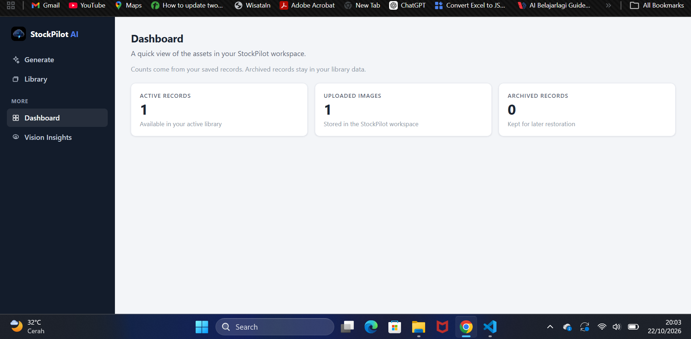
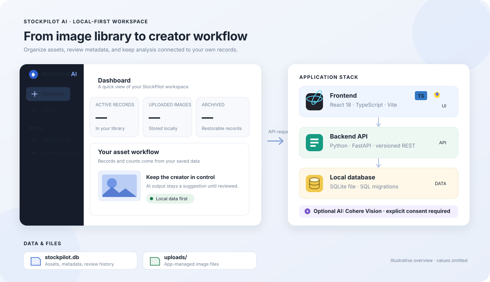
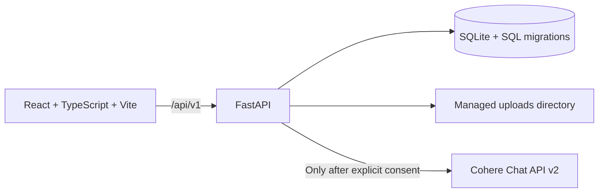
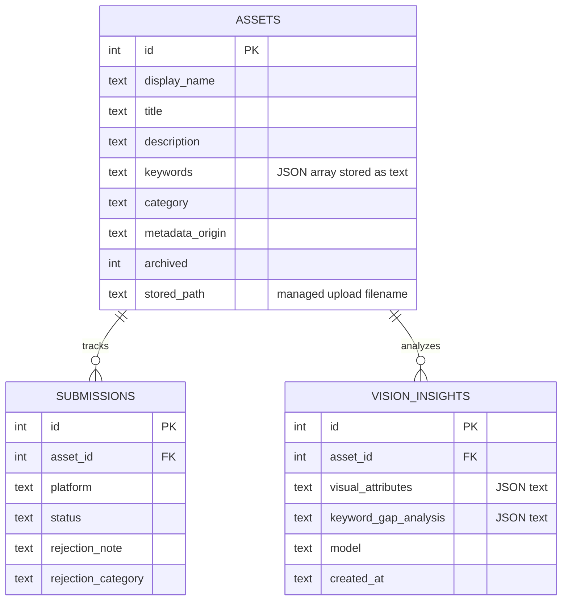

# StockPilot AI

**A local-first workspace for stock image creators to organize assets, prepare metadata, and review AI-generated image insights.**

StockPilot keeps an image library and its editable metadata in a local SQLite database. Optional Cohere analysis suggests metadata and visual observations; the creator reviews suggestions before applying them. Manual library work does not require an AI key.

     

**Status:** single-user MVP for localhost. It has no authentication and is not suitable for network exposure.

## Features

- **Library:** upload images; create, search, edit, archive, restore, and delete asset records; manage metadata and keywords.
- **Metadata suggestions:** optional Cohere vision output is a draft. It is not saved until reviewed and explicitly applied.
- **Vision Insights:** analyze an uploaded image for visual attributes, possible use cases, keyword gaps, metadata quality, and recommendations. Results are stored separately from asset metadata.
- **Review data:** the backend retains submission and rejection history endpoints and summarizes recorded data on the Dashboard. There is no standalone submission screen in the current UI.
- **Dashboard:** deterministic counts and date ranges from locally recorded data; no predictions about acceptance or sales.
- **Privacy controls:** both AI workflows require per-image consent before sending an image to Cohere.

CSV import/export, similarity scanning, multi-user accounts, and platform automation are not implemented.

## Application preview

This screenshot shows the running Dashboard. The colored illustration below it summarizes the app flow and technology stack.

[](docs/screenshots/dashboard.png)

[](docs/images/stockpilot-overview.svg)

## Architecture



The frontend is in `frontend/`. The Python API, services, and ordered SQL migrations are in `app/`. The backend stores records in SQLite and copied image uploads under `uploads/`. Provider calls are centralized in `app/services/cohere_service.py`; Cohere is optional and configured server-side.

### Database and stored data

StockPilot uses **SQLite**, an embedded database engine. It does not run a separate PostgreSQL or MySQL server: the live database is the binary file `stockpilot.db` in the repository root by default. The app opens it directly with Python's `sqlite3` module. `STOCKPILOT_DB_PATH` can point to a different file. SQL is the language used to define and query the tables; `app/migrations/*.sql` are the versioned schema-change scripts, not the database itself. FastAPI applies pending migrations when it starts and records them in `schema_migrations`.

That is why this local database does not appear automatically in pgAdmin 4 (a PostgreSQL client) or phpMyAdmin (a MySQL/MariaDB client). To inspect it, use a SQLite-compatible viewer such as **DB Browser for SQLite**, or query it with Python's `sqlite3`. The API's interactive docs at <http://127.0.0.1:8000/docs> show the application endpoints, not a database browser.

The main records and their relationships are:



One asset can have multiple submission records and multiple Vision Insights analyses. Deleting an asset cascades to those related records. Uploaded image files themselves are stored separately in `uploads/`; the database row keeps the managed filename. Back up **both** `stockpilot.db` and `uploads/` to preserve the full library. The ER diagram shows the principal application tables; `schema_migrations` is internal migration bookkeeping.

## Requirements

- Python 3.12
- Node.js and npm
- A Cohere API key only if you want AI generation or Vision Insights

## Run locally

On Windows, the repository includes a convenience script:

```powershell
.\start-stockpilot.ps1
```

It expects an existing Python virtual environment and `frontend\node_modules`. To install from a clean checkout, use two terminals:

```powershell
python -m venv .venv
.venv\Scripts\Activate.ps1
python -m pip install -r requirements.txt
python -m uvicorn app.main:app --host 127.0.0.1 --port 8000
```

```powershell
cd frontend
npm ci
npm run dev
```

Open <http://localhost:5173>. The Vite development server proxies `/api` requests to the backend on port 8000. Database migrations run when the backend starts. See [`.env.example`](.env.example) and [Operations](docs/OPERATIONS.md) for configuration. To enable AI, set `COHERE_API_KEY` in the root `.env`; never put it in frontend variables or source files.

## API

The API is versioned under `/api/v1`; interactive documentation is available at <http://127.0.0.1:8000/docs> while the backend runs.

| Method | Endpoint | Purpose |
|---|---|---|
| GET, POST | `/api/v1/assets` | Search/list and create records |
| GET, PATCH, DELETE | `/api/v1/assets/{id}` | Read, update/archive, or permanently delete a record |
| POST | `/api/v1/uploads` | Validate and store an image and create its record |
| GET | `/api/v1/images/{id}` | Serve an app-managed image |
| GET, POST | `/api/v1/submissions` | List and record review history |
| GET, PATCH, DELETE | `/api/v1/submissions/{id}` | Read, update, or delete one review record |
| GET | `/api/v1/insights/summary` | Summarize locally recorded data |
| GET | `/api/v1/ai/status` | Report whether AI is configured |
| POST | `/api/v1/ai/analyze` | Generate an unsaved metadata draft (requires consent) |
| POST, GET | `/api/v1/vision/analyze/{id}`, `/api/v1/vision/insights/{id}` | Generate and retrieve saved image insights (analysis requires consent) |

Example asset creation:

```powershell
Invoke-RestMethod -Method Post -Uri http://127.0.0.1:8000/api/v1/assets `
  -ContentType 'application/json' `
  -Body '{"display_name":"studio-light.jpg","title":"Soft studio light","keywords":["studio","light"]}'
```

Full schemas and response codes are in [the API reference](docs/API.md).

## Tests and build

```powershell
python -m pytest tests/ -v
```

This offline backend suite currently contains 92 tests. It uses temporary databases and upload directories and does not call Cohere. Build the frontend with:

```powershell
cd frontend
npm ci
npm run build
```

The optional `tests/smoke_live.py` is a separate live-provider smoke script; it requires a running server and configured Cohere credentials. See [Testing Strategy](docs/TESTING.md) before running it.

## Data and security

To back up local data, stop the backend and copy both `stockpilot.db` and `uploads/`. Asset deletion is permanent for the database record and its app-managed image; linked submission and Vision Insight records cascade. Files referenced by `file_reference` are not deleted.

The app has no authentication. Keep it bound to localhost and do not expose port 8000 to a network. Upload validation, consent requirements, environment configuration, known security gaps, and private reporting guidance are in [the security policy](docs/SECURITY.md).

## Repository map

| Path | Contents |
|---|---|
| `app/routes/` | FastAPI endpoints |
| `app/services/` | Asset, storage, insights, and Cohere/Vision logic |
| `app/migrations/` | Ordered SQLite schema migrations |
| `frontend/src/views/` | Generate, Library, Dashboard, and Vision Insights screens |
| `tests/` | Offline backend tests and separate live smoke script |
| `docs/` | Product, API, architecture, operations, testing, and security documentation |

