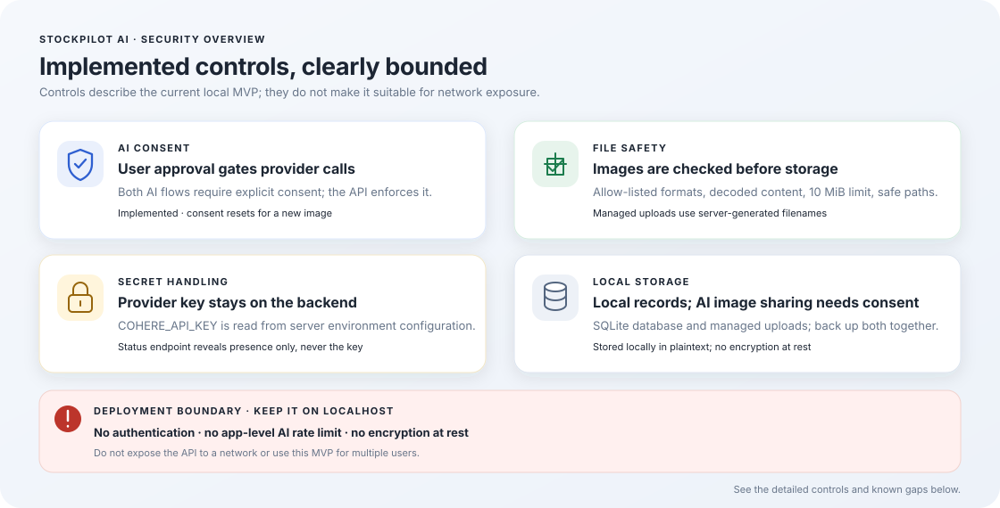

# Security Policy

StockPilot AI is an unauthenticated, single-user application intended to run
on one machine. The current MVP is the only supported version; no release or
branch support schedule is published.

## Security at a glance

This illustration summarizes implemented controls and deployment limits. It
is an orientation aid, not a security certification; the detailed policy and
known gaps below remain authoritative.

## Reporting a vulnerability

Do not publish API keys, credentials, personal data, exploit instructions, or
other sensitive details in a public issue. No private security contact is
configured in this repository. If the repository host offers private
vulnerability reporting, use that channel; otherwise contact the maintainer
privately through a channel already known to you. Do not post sensitive
details publicly when no private route is available.

Include the affected component or version, a concise impact description,
reproduction steps that avoid real user data, and any relevant logs with
secrets removed. The maintainer should acknowledge receipt and communicate
whether the issue is reproducible and what remediation is planned. No response
or fix timeline is guaranteed.

## Current controls

The controls below are implemented in the current code and are not a security
certification or guarantee:

## Data minimization
- Store only data needed for the creator's workflow.
- Do not collect Adobe credentials, session cookies, or private account data.
- Do not send assets or metadata to an external AI service without explicit
  disclosure and user action. **Met** — both AI endpoints require
  `consent: true`, rejected with `422` otherwise (ADR-010). The frontend shows
  a consent notice **and** an explicit "I agree to send this image to Cohere"
  checkbox on both the Generate and Vision Insights screens; the action button
  stays disabled until it is ticked, and the consent state resets when a
  different image is loaded.
- Make file storage and deletion behavior clear. **Met** — uploads are copied
  into a managed directory under server-generated names; deletion rules are
  documented in `docs/API.md` and surfaced in the UI confirmation dialog.

## Secrets
- Never commit `.env`, API keys, tokens, or passwords. **Met** — `.env` and
  `.env.*` are gitignored (only `.env.example` is tracked).
- Provide `.env.example` containing placeholders only. **Met**
- Keep secrets server-side; never place them in frontend source or
  Vite-exposed variables. **Met** — `COHERE_API_KEY` is read in
  `app/config.py` and never returned by any endpoint; `GET /api/v1/ai/status`
  reports only whether a key is *present*, never its value.
- If a real secret was committed, remove it from current code and rotate it. Deleting a file in a later commit does not erase Git history.

## File safety
- Restrict file operations to explicitly selected files or an
  application-managed directory. **Met** — the server only reads or writes
  inside `UPLOAD_DIR`; client-supplied paths are never used to locate files.
- Validate extension, MIME type where available, size, and image decoding.
  **Met** — `.jpg/.jpeg/.png/.webp` allow-list, magic-byte check, full Pillow
  decode, and a 10 MiB streaming size limit (`413` when exceeded).
- Generate safe internal filenames where copying files into managed storage.
  **Met** — server-generated names; the original filename is kept only as a
  display label.
- Prevent path traversal and arbitrary file reads. **Met** — the image path
  comes from the database row, and a path-traversal-safe resolver keeps
  resolved paths inside the managed directory.
- Never automatically delete originals. **Met** — nothing is deleted
  automatically. `DELETE /api/v1/assets/{id}` is an explicit, confirmed user
  action and only ever removes the app-managed copy; files referenced by
  `file_reference` are never touched (ADR-008).
- Do not leave orphaned files in managed storage. **Met** — if the database
  insert fails after the image was written, the file is removed before the
  error is re-raised, so the managed directory never keeps bytes that no
  asset row points to.

## API safety
- Validate request bodies and query parameters. **Met** — Pydantic models with
  field length limits, and pagination/status values validated by the service
  layer.
- Set upload size and request time limits. **Met** — upload size limit plus a
  60 s default Cohere timeout (`STOCKPILOT_AI_TIMEOUT`).
- Use appropriate CORS rules; do not use wildcard origins with credentials.
  **Met** — the origin list is restricted to `http://localhost:5173` by
  default and no credentials are enabled.
- Avoid exposing detailed stack traces to users. **Met** — handled errors
  return a `{"detail": "..."}` message; provider errors are summarized, and
  the raw upstream body is not returned to the browser.
- Add authentication before exposing a multi-user deployment. **Gap** — the
  MVP is deliberately unauthenticated and localhost-only (ADR-005). It must
  not be exposed to a network.
- Add rate limits to expensive AI or image-processing endpoints. **Gap** —
  not implemented. The Cohere provider does apply its own rate limits, which
  surface as a `429`.

## AI provider boundary
- All third-party calls go through one module. **Met** —
  `app/services/cohere_service.py` is the only module that imports `httpx`,
  which keeps the provider swappable and the blast radius of provider
  failures small.
- The provider must never see user data before consent. **Met** — the image
  is read and sent only inside a request that already passed the consent
  validator.
- Provider responses are untrusted input. **Met** — model output is parsed,
  normalized, and validated before anything is persisted. A schema echo is
  detected and rejected with `502` rather than stored (ADR-012).
- Provider errors must not leak credentials. **Met** — error messages name
  the configuration variable to fix, not its value.

## Database and backups
- Use parameterized queries or safe ORM/query-builder APIs. **Met** — all SQL
  is parameterized.
- Enable SQLite foreign-key enforcement. **Met** — `PRAGMA foreign_keys=ON`;
  deleting an asset cascades its submissions and vision insights.
- Document backup and restore. **Met** — `README.md` and
  `docs/OPERATIONS.md` describe stopping the backend and copying
  `stockpilot.db` and `uploads/`.
- Avoid logging full image metadata or user content unnecessarily. **Met** —
  logs carry request outcomes and error summaries, not image bytes or
  keywords.

## Release checklist
- No secrets in Git status or tracked files.
- Dependencies reviewed.
- Input validation and file restrictions tested.
- Errors do not expose secrets or stack traces.
- Backup/restore process verified.

## Known gaps and deployment limits
These are known and **not** yet closed. Do not describe them as mitigated.

- **No authentication.** The app is unauthenticated and must stay bound to
  `localhost` (ADR-005). Anyone with local access can read, write, and
  permanently delete every asset. This is the largest remaining risk.
- **No application-level AI rate limiting.** Each AI request costs a provider
  call, and the only limit is the 60 s request timeout. A loop of requests can
  burn the Cohere quota quickly.
- **Local storage is not encrypted at rest.** `stockpilot.db` and `uploads/`
  hold the original images and their metadata in plaintext.
- **Provider error detail is limited by the upstream provider.** When Cohere
  returns an unexpected failure, the exact cause stays provider-side; the app
  reports a generic message rather than leaking raw upstream payloads.

Keep the backend bound to localhost. Do not expose it to a network or use it
for multiple users until authentication, authorization, and rate limiting have
been designed and reviewed. Keep dependencies updated and review changes for
security impact before deployment. There is no automated dependency scanning
or formal release security process configured at present.
